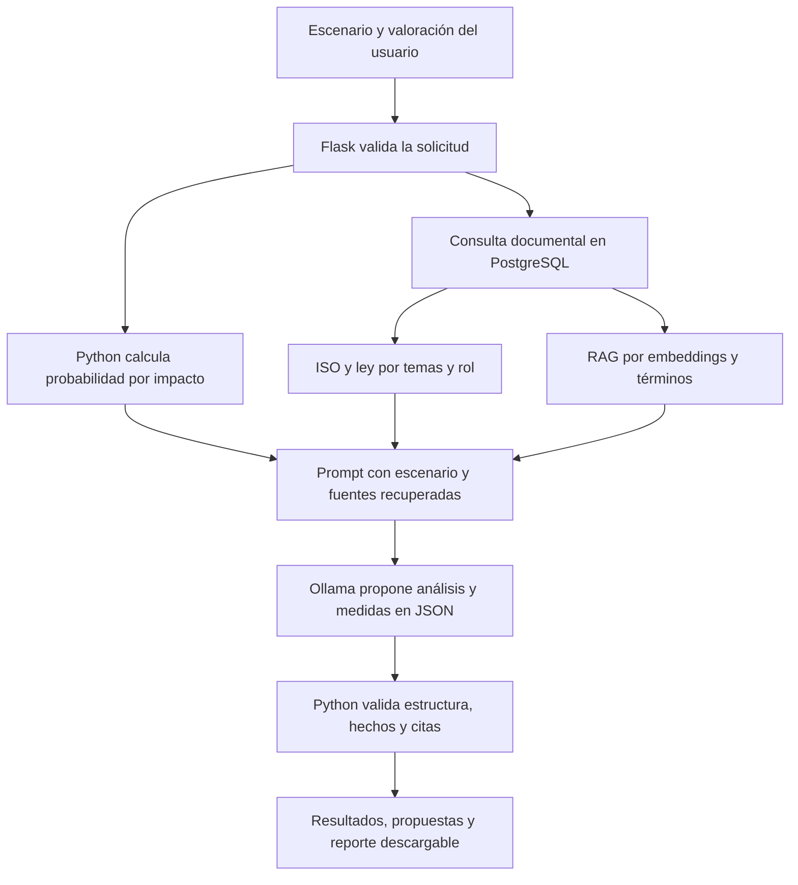

# Probar y explicar el agente de riesgos PIMS

## Preparar la demostración

En una terminal desde la raíz del repositorio:

```bash
cd agente_riesgos_pims_v2
.venv/bin/python -m db.local iniciar
bash iniciar.sh
```

Abre la dirección mostrada, normalmente <http://127.0.0.1:8080>.
En otra terminal, desde la misma carpeta, ejecuta `bash abrir_pgadmin.sh` y abre
<http://127.0.0.1:5050>. Mantén las terminales abiertas durante la demostración.
Ollama debe estar disponible con `qwen3.5:4b-q4_K_M` y `embeddinggemma` instalados.
El botón **Comprobar conexión** comprueba el servicio y los modelos de generación;
el inventario <http://127.0.0.1:8080/api/documentos> comprueba la lectura de la base.

## Caso de prueba

En **Evaluación**, selecciona `qwen3.5:4b-q4_K_M` y pega:

> Una universidad guarda DNI, correos y notas de estudiantes en una hoja de cálculo.
> El enlace permite lectura a cualquier persona sin iniciar sesión. Tres administrativos
> editan la hoja usando una misma cuenta compartida. Se realiza una copia diaria en una
> carpeta restringida. Los registros de egresados se conservan indefinidamente, sin plazo
> de conservación definido. No se ha confirmado ninguna filtración.

Selecciona probabilidad **4**, impacto **4**, rol **Responsable** y categorías
**Identificación**, **Contacto** y **Académicos**. Pulsa **Evaluar riesgo**.
Espera a que termine: la interfaz muestra el tiempo transcurrido y no entrega
el reporte por partes. En el ensayo del 3 de noviembre de 2026 tardó unos
100 segundos; el tiempo depende de la carga y del equipo.

En **Resultados** revisa:

1. La valoración del usuario: **4 × 4 = 16, Alto**. Se calcula en Python.
2. La segunda opinión de IA, que puede discrepar sin cambiar tu valoración.
3. Los riesgos, hechos citados, amenazas, vulnerabilidades y daños posibles.
4. Las referencias ISO y legales y los extractos recuperados por RAG.
5. Los avisos de revisión: indican límites del contenido, aunque las citas sean literales.

En **Tratamiento de riesgos** muestra las medidas propuestas y cómo comprobar
su aplicación. El riesgo residual requiere una valoración posterior; no se
afirma que las medidas ya estén ejecutadas. Descarga el resultado con
**Descargar reporte (.txt)** antes de recargar: no hay historial persistente.

## Cómo funciona



**Guion para explicarlo:** «El usuario describe un tratamiento de datos y propone
su probabilidad e impacto. El agente calcula esa valoración y busca fuentes en
su base PostgreSQL. Envía el caso y los extractos seleccionados a Ollama local,
que propone riesgos y medidas. Python comprueba la estructura, las evidencias
literales y la procedencia de las citas; después construye la pantalla y el
reporte. Las propuestas quedan pendientes de revisión y ejecución humana».

RAG significa recuperar información para apoyar la generación. Los documentos
se dividen en fragmentos; sus embeddings representan el texto numéricamente.
La consulta también se convierte en un vector y se compara con los guardados.
Esa similitud se combina con coincidencias de términos BM25 y se diversifican
las fuentes. Si falla el servicio de embeddings, se conserva la búsqueda por
términos. No se entrena ni se modifica el modelo durante una evaluación.

ISO y ley tienen además selección temática. El catálogo automático ISO es
parcial, de 13 controles, aunque la base actual almacena 78. Una búsqueda sin
resultados no prueba cumplimiento ni ausencia de riesgos.

## Mostrar la base de datos

En pgAdmin despliega **Agente de riesgos PIMS → PIMS - Riesgos (local) →
Databases → pims_riesgos → Schemas → pims_riesgos → Tables**.
Clic derecho en la tabla → **View/Edit Data → All Rows**.

| Tabla | Qué mostrar |
| --- | --- |
| `documentos` | Nombre, categoría, contenido, original y SHA256 de la fuente. |
| `fragmentos` | Texto, página, línea, sección y embedding de cada extracto. |
| `controles_iso` | Relación de controles con sus guías almacenadas. El agente usa su catálogo parcial de temas. |

La base actual contiene 7 documentos y 707 fragmentos: 78 ISO, 40 legales y
589 RAG. Los 589 RAG tienen embeddings. Son las cantidades verificadas en este
equipo, no requisitos fijos. La aplicación usa un usuario lector; pgAdmin usa
el administrador local. Evita editar los registros durante la demostración.

## Resultado del ensayo real

El 3 de noviembre de 2026 se ejecutó:

```bash
.venv/bin/python -u comprobar_ia.py --entrada ejemplo_calidad_rag.json --salida ../.datos/reporte_ia_funcional.txt
```

El análisis terminó en 99,7 segundos y produjo un reporte de IA con 3 referencias
ISO, 2 legales y 4 RAG con citas cotejadas. Se recuperó contexto mediante
**semántica + términos sobre PostgreSQL**. El reporte local está en
`.datos/reporte_ia_funcional.txt`; no se publica en Git.

El contenido quedó marcado **requiere_revision_por_alertas**: el modelo usó IDs
documentales F como si identificaran hechos del caso y propuso un riesgo de
restauración a partir de información no confirmada. Esto permite demostrar
también los límites: el sistema funciona de extremo a extremo, pero verificar
una cita no garantiza que la interpretación o la medida sean correctas.
No presentar ese riesgo de respaldo como una carencia demostrada.

Después se probó `POST /api/evaluar` en la aplicación reiniciada con
`ejemplo_solicitud.json` y `exigir_ia: true`: HTTP 200, reporte de IA válido,
79,8 segundos, puntaje 16 (Alto), 4 riesgos y citas cotejadas de 3 referencias
ISO, 2 legales y 3 RAG. No se detectaron alertas automáticas en ese segundo caso;
el estado sigue siendo `pendiente_de_revision`. La respuesta se conserva en
`.datos/prueba_api_funcional.json`. Esta prueba verifica también el recorrido
HTTP que usa el formulario, además de la ejecución desde la terminal.

Las pruebas automatizadas cubren cálculo, API, validación, interfaz y recuperación.
Las cuatro pruebas SQL nuevas comprueban ambos formatos de almacenamiento y la
coherencia de texto y procedencia entre recuperación léxica y vectorial.
No se reimportó ni se modificó el corpus para corregir la lectura.

## Si algo falla

| Síntoma | Acción |
| --- | --- |
| Inventario devuelve 503 | Inicia PostgreSQL con `.venv/bin/python -m db.local iniciar`. Revisa las conexiones de `.env`. |
| No aparecen modelos | Comprueba `ollama list`; si no hay servicio, inicia `ollama serve`. |
| Error de generación o timeout | Revisa el mensaje, la carga del equipo y el modelo seleccionado. El límite predeterminado es de 900 segundos por intento. |
| pgAdmin no abre | Ejecuta `bash abrir_pgadmin.sh` en otra terminal y mantenla abierta. |
| Cambiaste código Python | Detén la terminal de la aplicación con Ctrl+C y ejecuta `bash iniciar.sh` otra vez. |

No ejecutes `db.migrar` para solucionar un problema de conexión: es una
importación, no un inicio de servicio. Ese importador conserva el formato
histórico y requiere adaptar su escritura antes de usarlo sobre esta base
normalizada. Consulta `agente_riesgos_pims_v2/db/OPERACION.txt` para respaldos
y operación del clúster.
