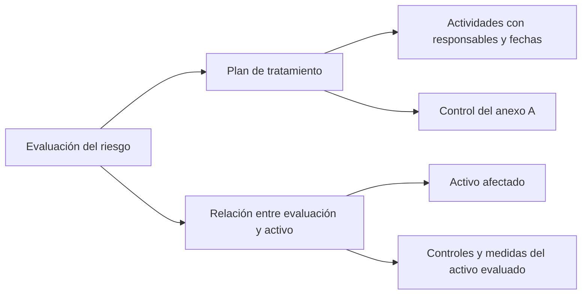

# Qué contiene gestitel_base_de_datos.sql

El archivo original permanece local y no se incluye en la rama compartida.
La implementación y su demostración no dependen de distribuirlo.

Es una exportación SQL de PostgreSQL de la plataforma Gestitel, preparada como
referencia para revisión. Incluye instrucciones para crear tablas, relaciones,
índices y cargar sus datos iniciales. No es una aplicación ejecutable ni añade
pantallas al agente por sí sola.

El encabezado indica que fue generado el 21 de octubre de 2026 a partir de
migraciones Django. La revisión siguiente se hizo leyendo el archivo local;
no se importó en la base del agente.

## Organización

| Esquema | Tablas | Contenido |
| --- | ---: | --- |
| `public` | 15 | Empresas, dominios, licencias, configuración de IA y tablas de Django. |
| `demo` | 58 | Estructura de una empresa de ejemplo: activos, riesgos, controles, documentos, incidentes, auditorías y otros módulos. |

El archivo tiene 73 tablas. Sus tablas de usuarios y sesiones están vacías;
las evaluaciones, controles asociados a riesgos, planes y actividades de
tratamiento también están vacíos. Por tanto, aporta la estructura para registrar
casos futuros, además de catálogos y configuración inicial, no evaluaciones
de clientes que podamos usar como ejemplos completos.

Catálogos relevantes comprobados en el archivo:

- 142 controles: 93 etiquetados `ISO27001_2022` y 49 `ISO27701_2025`.
- 69 requisitos en la matriz de brecha.
- Matrices de dimensiones 5×5, 4×4 y 3×3, con 12 rangos de riesgo en total.
- Un periodo inicial de evaluación.

Estos recuentos describen el archivo; no acreditan por sí solos que sus catálogos
sean equivalentes a los documentos o a los criterios de nuestro agente.

## Qué partes sirven para nuestro agente

| Tabla de Gestitel en `demo` | Función | Relación con lo que tenemos |
| --- | --- | --- |
| `core_riskevaluation` | Código, descripción, amenaza, vulnerabilidad, responsable, valoración, estado, verificación y riesgo residual. | El agente genera parte de esta información, pero conserva la evaluación en la pantalla y en el reporte descargado. |
| `core_riskevaluationasset` | Vincula una evaluación con los activos afectados. | El formulario actual describe un escenario; todavía no selecciona activos de un inventario. |
| `core_riskcontrol` | Controles y medidas asociados a la relación entre evaluación y activo. | Permitiría distinguir controles existentes de nuevas medidas propuestas. |
| `core_risktreatment` | Plan vinculado a la evaluación y, opcionalmente, a un control del anexo A. | Se aproxima a la medida propuesta por cada riesgo. Requiere guardar una relación real con la evaluación. |
| `core_risktreatmentactivity` | Actividades del plan, área, responsable, inversión, duración y fechas. | Es una referencia para añadir seguimiento después de que una persona apruebe el plan. |
| `core_annexacontrol` | Catálogo de controles, norma, rol y relaciones legales declaradas. | Sirve para comparar códigos y procedencias con nuestro catálogo; no corresponde importarlo como equivalencia automática. |
| `core_evaluationmatrix`, `core_matrixlevel`, `core_riskrange` | Dimensiones, niveles de los ejes y rangos de clasificación. | Permitirían configurar la matriz en lugar de fijar todos los umbrales en Python. |
| `core_riskperiod` | Periodo y datos de configuración asociados. | Puede orientar un historial de evaluaciones y reevaluaciones. |

Las relaciones declaradas del módulo de tratamiento se pueden leer así:

## Una diferencia que debemos resolver antes de integrar

La matriz 5×5 no clasifica igual un puntaje 12:

| Nivel | Agente actual | Semilla 5×5 de Gestitel |
| --- | --- | --- |
| Bajo | 1–5 | 1–5 |
| Medio | 6–11 | 6–12 |
| Alto | 12–19 | 13–19 |
| Crítico | 20–25 | 20–25 |

Además, el registro 4×4 tiene estado `A` y los registros 5×5 y 3×3 tienen estado
`I`. El archivo no contiene el código Django que define esas opciones; hay que
confirmar la configuración efectiva de Gestitel antes de atribuirle una matriz
operativa. No se cambió la escala del agente a partir de este archivo.

## Qué se mejoró ahora y qué sería una integración posterior

La tabla de la aplicación se reorganizó en **riesgo y prioridad**, **medida
propuesta**, **cómo verificar** y **seguimiento**. El código se agrupa con el
nombre del riesgo, se conserva el hecho del escenario como detalle desplegable
y la vista se adapta a pantallas pequeñas. La búsqueda también incluye la
verificación. El estado continúa siendo una propuesta por revisar y el riesgo
residual queda pendiente de reevaluación.

Para una integración con Gestitel habría que acordar la matriz y los códigos de
estado, resolver usuarios/activos/periodos, guardar evaluaciones y convertir cada
medida aprobada en un plan y sus actividades. No basta con copiar los nombres de
las columnas. La IA no debe completar responsables, fechas, evidencias de
ejecución ni riesgos residuales como si fueran hechos ya comprobados.

Para examinar el SQL en pgAdmin se puede restaurar en una base separada de
revisión. Contiene comandos propios de `psql` y bloques `COPY`, así que no es
un script para pegar completo en el editor de consultas. El archivo fue generado
con `pg_dump` 18.4; conviene verificar la compatibilidad del cliente de
restauración, especialmente los comandos `\restrict` y `\unrestrict`.

**Para explicárselo al ingeniero:** «El archivo nos muestra cómo Gestitel organiza
los riesgos, sus controles, planes y actividades. Podemos usarlo como referencia
para estructurar la salida del agente y preparar su integración. Nuestro agente
ya genera propuestas; todavía necesitamos persistir y gestionar su aprobación y
seguimiento, y acordar la misma matriz de valoración».
